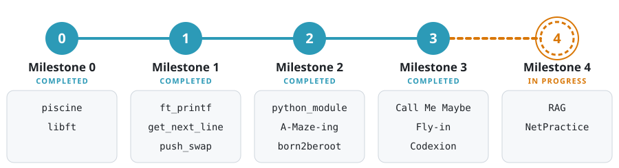

<!-- ================= Header ================= -->
<p align="center">
  
</p>

<p align="center">
  <a href="https://github.com/takutotakuto1121-creator">
    
  </a>
</p>

<p align="center">
  
  
  
</p>

---

## 🧑‍💻 About Me

```python
class TakutoSugimoto:
    name       = "杉本 拓斗"
    university = "早稲田大学 人間科学部 人間情報科学科"
    school     = "42 Tokyo"
    languages  = ["C", "Python"]
    interests  = ["Algorithms", "Linux / Network", "LLM"]

    def now(self):
        return "42 cursus Milestone 4 に挑戦中 🚀"
```

- 🎓 **早稲田大学** 人間科学部 人間情報科学科に在籍
- 🏫 **42 Tokyo** で C / Python を軸に、低レイヤからアルゴリズム、Linux、ネットワーク、LLM まで幅広く学習中
- 📝 学んだことは各リポジトリの README にまとめています

## 🛠 Tech Stack

<p align="center">
  <a href="https://skillicons.dev">
    
  </a>
</p>

| Category | Skills |
| :--- | :--- |
| **Languages** | C, Python|
| **Topics** | メモリ管理 / システムコール / ソートアルゴリズム / グラフ探索 / TCP/IP / LLM |
| **Environment** | Linux, Git, Make, VS Code |

## 🗺 42 Journey

<p align="center">
  <picture>
    <source media="(prefers-color-scheme: dark)" srcset="assets/journey-dark.svg">
    
  </picture>
</p>

42Tokyoの課題一覧です。AIの使用は控えており、コードの大部分が手書きです。

> 各 Milestone をクリックすると、プロジェクトの詳細が開きます 👇

<details>
<summary><b>✅ Milestone 0</b> — <code>piscine</code> · <code>libft</code></summary>
<br>

| Project | Description | Key Topics |
| :--- | :--- | :--- |
| [**piscine**](https://github.com/takutotakuto1121-creator/piscine) | 42 入学試験「Piscine」の課題。Shell00 と C00〜C10 を通して、シェルの基礎から C 言語のポインタ・文字列・メモリ確保までを集中的に学習 |   ポインタ / 再帰 / `malloc` |
| [**libft**](https://github.com/takutotakuto1121-creator/libft) | 42 cursus 最初の課題。C 標準ライブラリ関数の再実装と、以降の課題で使う自作ライブラリの作成 |  メモリ管理 / 文字列操作 / 連結リスト |

</details>

<details>
<summary><b>✅ Milestone 1</b> — <code>ft_printf</code> · <code>get_next_line</code> · <code>push_swap</code></summary>
<br>

| Project | Description | Key Topics |
| :--- | :--- | :--- |
| [**ft_printf**](https://github.com/takutotakuto1121-creator/ft_printf) | `printf` の再実装。可変長引数を扱い、各種変換指定子に対応 |  可変長引数 (`stdarg`) |
| [**get_next_line**](https://github.com/takutotakuto1121-creator/get_next_line) | ファイルディスクリプタから 1 行ずつ読み込む関数。`read()` の呼び出しを最小限に抑えるバッファリング設計 |  static 変数 / `read(2)` / バッファリング |
| [**push_swap**](https://github.com/takutotakuto1121-creator/push_swap) | 2 つのスタックと限られた命令だけで整数列をソートし、命令数の最小化を目指す |  ソートアルゴリズム / 計算量 |

</details>

<details>
<summary><b>✅ Milestone 2</b> — <code>python_module</code> · <code>A-Maze-ing</code> · <code>born2beroot</code></summary>
<br>

| Project | Description | Key Topics |
| :--- | :--- | :--- |
| [**python_module**](https://github.com/takutotakuto1121-creator/python_module) | Module 00〜10 を通して Python を基礎から体系的に学習 |  Python 全般 |
| [**A-Maze-ing**](https://github.com/takutotakuto1121-creator/A-Maze-ing) | 迷路の生成・最短経路探索・可視化（ペア課題）。中央に「42」を描く完全迷路／Pac-Man 向け迷路を生成 |  Prim / Kruskal / 再帰的バックトラック / BFS |
| [**born2beroot**](https://github.com/takutotakuto1121-creator/born2beroot) | Debian の仮想マシンを構築し、LVM・SSH・ファイアウォール・sudo・パスワードポリシーを設定。監視用シェルスクリプトも作成 |  Linux / システム管理 |

</details>

<details>
<summary><b>✅ Milestone 3</b> — <code>Call Me Maybe</code> · <code>Fly-in</code> · <code>Codexion</code></summary>
<br>

| Project | Description | Key Topics |
| :--- | :--- | :--- |
| [**Call Me Maybe**](https://github.com/takutotakuto1121-creator/Call-Me-Maybe) | Constrained Decoding により、LLM に指定フォーマットの JSON を確実に出力させる。トークン生成の過程をアニメーション表示する機能つき |  LLM / Constrained Decoding |
| [**Fly-in**](https://github.com/takutotakuto1121-creator/Fly-in) | 複数のドローンを同時にスタートさせ、ゾーンや通路容量の制約下で全機を効率よくゴールへ導く |  マルチエージェント経路探索 / 最大流 |
| [**Codexion**](https://github.com/takutotakuto1121-creator/Codexion) | 「食事する哲学者問題」の応用。コーダーが両隣のドングルを取り合いながらコンパイルを続けるシミュレーション。クールダウンと FIFO / EDF スケジューラによる調停を実装 |  マルチスレッド / mutex / デッドロック回避 / スケジューリング |

</details>

<details>
<summary><b>🚧 Milestone 4</b> — <code>RAG against the machine</code> · <code>NetPractice</code></summary>
<br>

| Project | Description | Key Topics |
| :--- | :--- | :--- |
| [**RAG against the machine**](https://github.com/takutotakuto1121-creator/RAG-against_the_machine-) | 🚧 *In Progress* — 検索拡張生成（RAG）によるドキュメント・コードに関する質問応答システム |  RAG / LLM / vLLM |
| [**NetPractice**](https://github.com/takutotakuto1121-creator/NetPractice) | IP アドレッシング・サブネット・ルーティングの演習。OSI 参照モデルから TCP/IP までの学習ノートつき |  TCP/IP / サブネット / ルーティング |

</details>

## 🌱 Other Projects

42 の課題以外で取り組んだハッカソン・個人開発のプロジェクトです。クリックで開きます 👇

<details>
<summary><b>🌱 Other Projects</b> — <code>ツメショー (SPAJAM2026)</code> · <code>MAPF</code> · <code>のむしょう</code> · <code>deep-learning-from-scratch</code></summary>
<br>

| Project | Description | Key Topics |
| :--- | :--- | :--- |
| [**ツメショー**](https://github.com/koji18/test_spajam_tumesho)<br><sub>SPAJAM2026 / チーム開発</sub> | 1 問 1 分の詰将棋を、ショート動画のように縦スワイプで次々に解く iOS アプリ。問題はアプリ内で自動生成されるので尽きない。詰ませた瞬間に和紙風の画面がネオン＋BGM に切り替わる演出つき。5 人チームで開発し、**チュートリアルモード**を担当 |   ハッカソン / チーム開発 / iOS |
| [**MAPF**](https://github.com/takutotakuto1121-creator/-MAPF-) | マルチエージェント経路探索（MAPF）の学習・実験用フレームワーク。A* / CBS / ECBS / PIBT / LaCAM / LNS など 10 種のアルゴリズムを標準ライブラリのみで実装し、CLI で切り替えて比較できる |  探索アルゴリズム / 論文実装 / pytest |
| [**のむしょう**](https://github.com/takutotakuto1121-creator/discord-bot-nomusyo) | 毎朝 7:00 にニュース 10 件を Claude で要約して Discord に投稿する Bot。GitHub Actions の cron で動くサーバーレス構成 |    RSS / LLM 要約 / Webhook |
| [**deep-learning-from-scratch**](https://github.com/takutotakuto1121-creator/deep-learning-from-scratch) | 『ゼロから作る Deep Learning』を参考に、パーセプトロンからニューラルネットワークまでを NumPy で実装。MNIST の推論まで |   ニューラルネットワーク / 活性化関数 |

</details>

## 📊 GitHub Stats

<p align="center">
  <picture>
    <source media="(prefers-color-scheme: dark)" srcset="https://github-profile-summary-cards.vercel.app/api/cards/stats?username=takutotakuto1121-creator&theme=github_dark">
    
  </picture>
  <picture>
    <source media="(prefers-color-scheme: dark)" srcset="https://github-profile-summary-cards.vercel.app/api/cards/repos-per-language?username=takutotakuto1121-creator&theme=github_dark">
    
  </picture>
</p>

<p align="center">
  <picture>
    <source media="(prefers-color-scheme: dark)" srcset="https://streak-stats.demolab.com?user=takutotakuto1121-creator&theme=github-dark-blue&hide_border=true&background=00000000">
    
  </picture>
</p>

<!-- ================= Footer ================= -->
<p align="center">
  
</p>

<p align="center">
  
</p>
